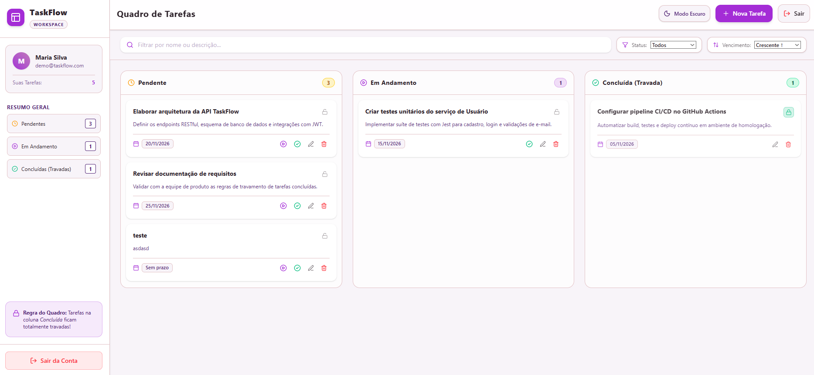

# TaskFlow Web

Angular client for the [TaskFlow API](https://github.com/BrunoGomes99/task-flow-api): register, log in, and manage your own tasks on a Kanban board.



> **Status:** requirements and architecture approved; implementation not started. The API changes the frontend depends on are being specified in task-flow-api first.

## Features

- Login and registration with JWT authentication.
- Kanban board with Pending, In Progress and Completed columns, with infinite scroll per column.
- Drag-and-drop between columns (mouse and touch), plus keyboard-friendly quick actions.
- Completed tasks are locked: they cannot return to a previous status.
- Filters by title, description and status; sorting by due date.
- Create, view, edit and delete tasks in a dialog with its own URL.
- Sidebar with the user profile and a per-status summary.
- Light and dark themes, following the operating system by default.

## Tech Stack

Angular 22 (standalone, zoneless, signals) · TypeScript strict · Angular CDK · Tailwind CSS v4 · Lucide icons · Vitest + Angular Testing Library · Playwright + axe-core · angular-eslint + Prettier.

## Prerequisites

- **Node.js 24 LTS** (Angular 22 requires `^22.22.3`, `^24.15.0` or `>=26`).
- **npm**.
- **Docker**, to run the TaskFlow API locally.

## Getting Started

The commands below become available once the Phase 1 setup lands.

1. Start the API from the task-flow-api repository (it listens on `http://localhost:8080`):

   ```bash
   docker compose up taskflow.api
   ```

2. Install and run the frontend (the dev server proxies `/api` to the local API):

   ```bash
   npm install
   npm start
   ```

3. Open `http://localhost:4200`.

## Documentation

| Document | Content |
|----------|---------|
| [docs/PROJECT_SPEC.md](docs/PROJECT_SPEC.md) | Requirements and business rules |
| [docs/ENGINEERING_GUIDELINES.md](docs/ENGINEERING_GUIDELINES.md) | Development standards and checklists |
| [docs/ARCHITECTURE.md](docs/ARCHITECTURE.md) | Current architecture and diagrams |
| [docs/adr/](docs/adr/) | Architecture decision records |
| [docs/design/](docs/design/) | Figma prototype screenshots and code (visual reference only) |

## Contributing

Create feature branches from `dev` and open pull requests to `dev`. Commits follow [Conventional Commits](https://www.conventionalcommits.org/).
