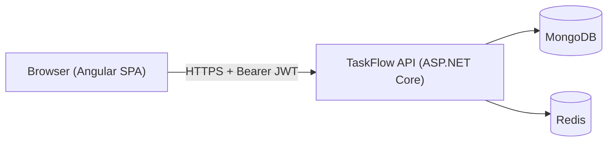
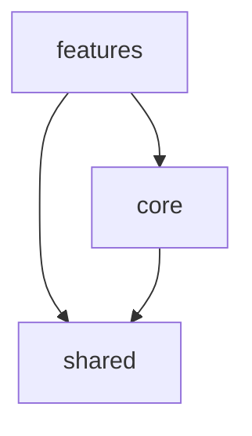
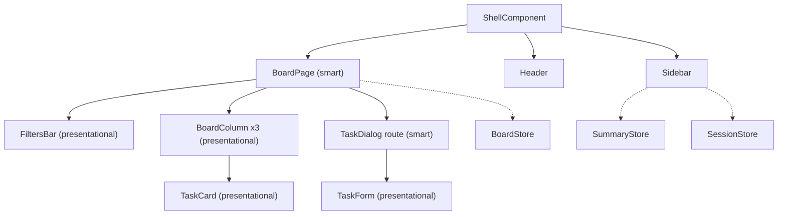
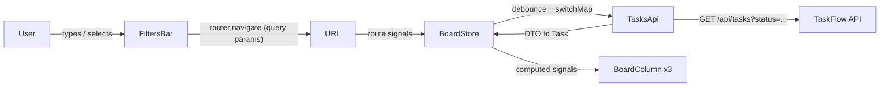
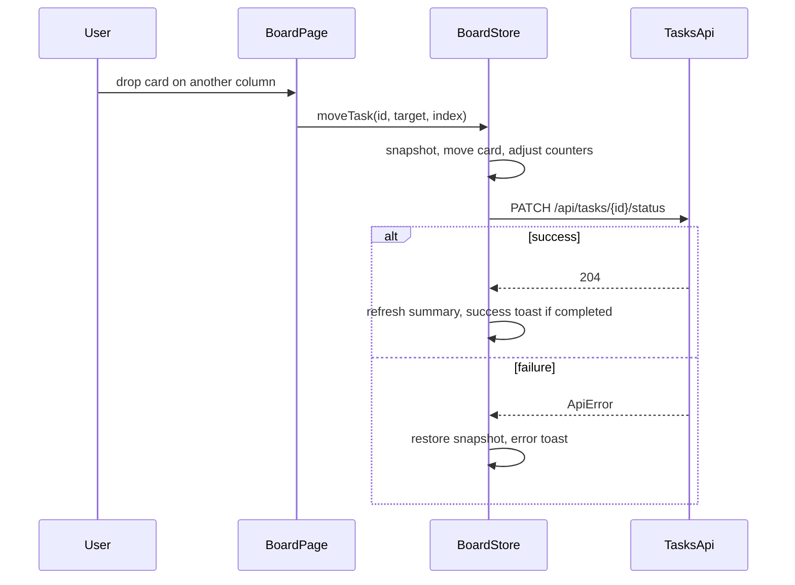
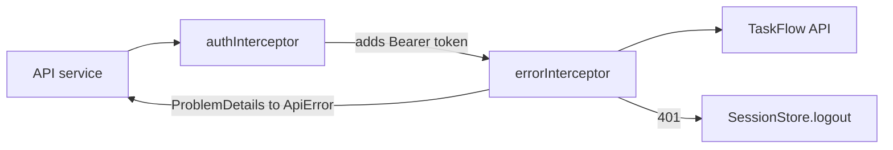
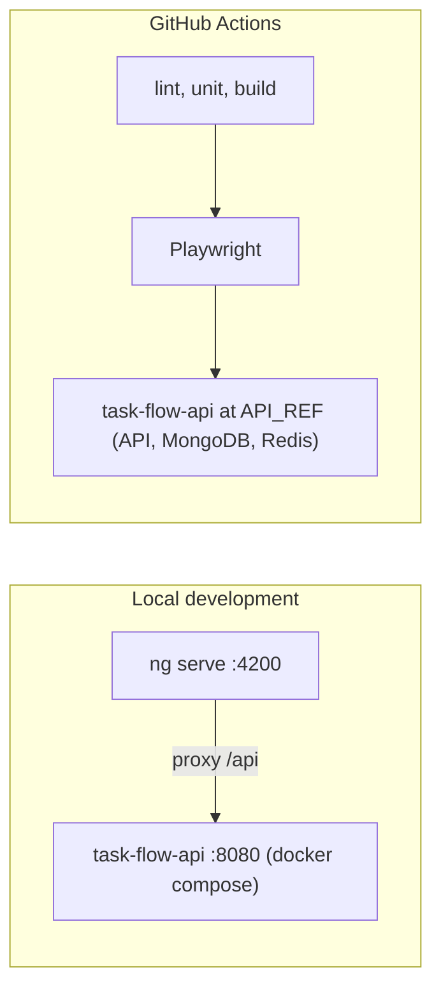

# TaskFlow Web — Architecture

This document explains the architecture of the TaskFlow SPA and how its parts fit together. It describes the **current** architecture; update it whenever the architecture changes. The reasons behind individual decisions are in [adr/](adr/).

> **Status (2026-11-12):** approved target architecture. No application code exists yet.

---

## 1. Overview

TaskFlow Web is a client-side Angular 22 SPA. It talks only to the TaskFlow REST API, authenticates with a JWT, and keeps state in signal-based stores.



For a .NET developer, the layers map roughly like this:

| Frontend | Backend analogy |
|----------|-----------------|
| Page (smart) component | Controller: receives input, calls use cases, returns a view |
| Presentational component | Razor partial / view component with only a model |
| Feature store | Application service holding state, with commands and queries |
| API service + mapper | Repository / HTTP client adapter, mapping DTOs to domain models |
| Interceptor | Middleware / `DelegatingHandler` |
| Guard | Authorization filter |
| `inject()` and providers | Dependency injection container |
| Signal | Observable property with automatic dependency tracking |

---

## 2. Layers and Folders

```text
src/app/
  core/                     App-wide singletons, loaded once
    api/                    Generated OpenAPI types, ApiError, base URL
    auth/                   Session store, auth API, interceptors, guards
    layout/                 Shell: sidebar, header
    theme/                  Theme store (light/dark)
    notifications/          Toast store and outlet
  shared/                   Reusable, app-agnostic
    ui/                     Button, form field, dialog, confirm dialog, toast,
                            tooltip, multi-select, avatar, badge
    utils/                  Date utilities, validators
  features/
    auth/
      pages/                Login, register
    tasks/
      data-access/          Tasks API, mappers, board store, summary store
      models/               Task, TaskStatus, BoardFilters
      pages/                Board page, task dialog route
      components/           Column, card, filters bar, task form
api-contract/
  openapi.json              Versioned snapshot of the API contract
  API_REF                   task-flow-api commit/tag the snapshot came from
e2e/
  real/                     Flows against the real API
  mocked/                   Edge cases with mocked network
```

### Dependency rules



- `shared` knows nothing about TaskFlow; it could move to another app.
- Features never import each other. Anything two features need goes to `core` (app-wide state) or `shared` (generic UI/utilities).
- Inside a feature: `pages` → `components` and `data-access`; `components` are presentational and import only `models` and `shared`.

---

## 3. Components



Solid arrows are template composition; dotted arrows are injection. Only smart components (and the shell) inject stores. Presentational components receive data through `input()` and report intent through `output()`; this keeps them trivially testable.

---

## 4. State

Each store is an injectable service with private writable signals, public read-only signals, and command methods. There is no state library ([ADR 0001](adr/0001-signal-stores-without-state-library.md)).

| Store | Scope | Holds |
|-------|-------|-------|
| `SessionStore` | root | Token, expiry, profile, logout timer |
| `ThemeStore` | root | Current theme, persistence |
| `ToastStore` | root | Visible toasts |
| `BoardStore` | board route | Per-column items, page, total, loading, `hasMore` |
| `SummaryStore` | root | Count per status (unfiltered) |

### Board data flow

The URL is the source of truth for filters ([ADR 0004](adr/0004-url-is-the-source-of-truth-for-board-filters.md)). Each visible column queries the API with its own status and page ([ADR 0003](adr/0003-board-loads-each-column-independently.md)).



Query parameters: `title`, `description`, `status` (comma-separated visible statuses), `order` (`asc` | `desc`).

### Optimistic status change



Moving to Completed opens a confirm dialog before `moveTask` runs ([ADR 0008](adr/0008-optimistic-moves-and-card-placement.md)).

---

## 5. HTTP and Authentication



- Types are generated from `api-contract/openapi.json` ([ADR 0006](adr/0006-api-types-from-versioned-openapi-snapshot.md)); API services map DTOs to models.
- The session is kept in `localStorage` ([ADR 0007](adr/0007-jwt-in-local-storage-without-refresh.md)): on login the store saves the token and `expiresAt = now + expiresIn`, schedules a logout at `expiresAt`, and loads the profile.
- On startup, a stored, non-expired session is restored; an expired one is discarded.
- Guards: `authGuard` protects the board; `guestGuard` keeps logged users away from `/login` and `/register`.
- In development, the Angular dev server proxies `/api` to the local API, so CORS is not involved.

---

## 6. Routing

| Route | Component | Guard |
|-------|-----------|-------|
| `/login` | Login page | guest |
| `/register` | Register page | guest |
| `/tasks` | Shell + board | auth |
| `/tasks/new` | Task dialog (create), child of `/tasks` | auth |
| `/tasks/:id` | Task dialog (view/edit), child of `/tasks` | auth |
| `/` (empty path) | redirect to `/tasks` | — |

Feature routes are lazy-loaded. The task dialog is a child route, so the board stays rendered behind it and the dialog can be opened by URL.

---

## 7. Theming

Design tokens (palette and semantic colors such as `--color-accent-text` or `--color-danger`) are CSS custom properties defined per theme. Tailwind utilities reference the tokens, so components never contain raw colors. A small inline script in `index.html` sets the `dark` class on `<html>` before Angular boots, using the saved choice or `prefers-color-scheme`.

---

## 8. Development and CI Topology



See [ADR 0009](adr/0009-hybrid-e2e-against-real-api.md) for the E2E strategy.

---

## Document History

- **2026-11-12:** Initial target architecture.
